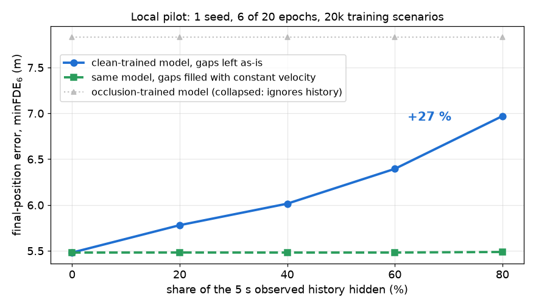

# occlusion_forecast

**How much worse does a self-driving motion forecaster get when part of a car's past is hidden — and can that
be bought back?** A measurement pipeline on Argoverse 2 that hides parts of each vehicle's observed history in
controlled patterns and scores the forecasts with the official metrics.

**Pilot result in one line:** hiding 80 % of a car's past makes the forecast's end point 27 % less accurate, and
filling the gaps with a simple constant-speed guess recovers it — on a small, under-trained laptop model.

> **Status:** pipeline built and its scoring checked against published numbers; laptop pilot done. The full
> experiment (3 training seeds per method on the whole dataset, ~260 GPU-hours on a cluster) has not been run,
> so every result below is pilot-scale.

<p align="center"></p>
<p align="center"><sub>1,500 validation scenarios, one seed, 6 of 20 epochs, 20,000 training scenarios (~1/10 of the training split). Numbers:
<a href="results/pilot_summary.json"><code>results/pilot_summary.json</code></a>; figure: <code>python scripts/plot_pilot_curve.py</code>.</sub></p>

**Terms.** *Argoverse 2*: a public dataset of recorded driving scenes. *SIMPL*: an open-source forecasting model.
Each forecast is six guessed future paths; **minFDE₆** = distance in metres between where the car really ended up
and the closest of the six guesses' end points, **minADE₆** = the same averaged over the whole path,
**miss rate** = share of cases where all six end points are more than 2 m off.

## Results

| check | result | source |
|---|---|---|
| Is our scoring code right? | **Yes** — the published QCNet checkpoint scored through this pipeline (all 24,988 val scenarios): minADE₆ / minFDE₆ / miss rate 0.720 / 1.253 / 0.157 vs published 0.72 / 1.25 / 0.16 | [QCNet run](results/g_n1_0_checkpoint_eval.json), [published](results/qcnet_published_val.json) |
| Does hiding history hurt? (pilot) | **Yes** — minFDE₆ 5.48 → 6.97 m (+27 %) from 0 % to 80 % hidden | [pilot](results/pilot_summary.json) |
| Does a cheap fix work? (pilot) | Constant-speed gap filling keeps minFDE₆ at 5.48–5.49 m at every level | [pilot](results/pilot_summary.json) |
| Does training on hidden history help? (pilot) | **Unanswered** — that model collapsed into ignoring history (identical output at every level); checked, not a code bug | [collapse check](results/c3_collapse_verification.json) |

How to read the pilot:

- **Only the change within the pilot matters, not its absolute level.** The pilot model was retrained from scratch
  on a laptop for 6 of 20 epochs on ~1/10 of the training data; its 5.48 m clean error compares with 1.45 m for the SIMPL
  authors' fully trained checkpoint ([`simpl_vendor_manifest.json`](results/simpl_vendor_manifest.json)).
- **Why gap filling looks perfect:** in this test the car is visible again at the end of its history, so every gap
  sits between real observations and a straight-line fill is close to exact. A small model that leans mostly on the
  last positions also gains little from the rest of the history. Neither may hold for a fully trained model.
- **The QCNet check validates the scoring path** (official metric code, data handling), not the SIMPL training
  path. The planned decisive test — ≥ 3 seeds per method and a paired significance test fixed in advance in
  [`gates.yaml`](gates.yaml) — was never run.

## How it works

1. **Mask.** `otraj.masking` picks, per scenario and deterministically from its id, one of three occlusion
   patterns — a contiguous gap, a late appearance, or on/off flicker — mixed in proportions measured from simulated
   occlusions in an earlier CARLA tracking project ([stats](results/p2_occlusion_stats.json)), at five levels
   (0 / 20 / 40 / 60 / 80 % of the 5 s history hidden).
2. **Forecast.** A SIMPL model (MIT licence) predicts six future paths from the masked history. For the pilot it was
   retrained locally in three variants: clean training, training on masked histories, and the clean model with
   gaps filled by constant velocity.
3. **Score.** The official `av2` kit computes minADE₆, minFDE₆ and miss rate on the same masks for every variant
   (manifests in [`results/mask_manifests/`](results/mask_manifests/)).

The masked-history protocol is our own — the Argoverse 2 leaderboard does not measure it; only the metric code is
official.

## Quickstart

Python 3.11, [uv](https://docs.astral.sh/uv/), an NVIDIA GPU for training and evaluation (the pilot ran on an
RTX 4060 laptop, 8 GB). The unit tests and the licence guard run without data or GPU. Pinned versions:
`requirements.txt` (all `==`); the PyTorch pin is the CUDA 12.6 build (~2.5 GB download).

```bash
git clone https://github.com/matus012/occlusion_forecast && cd occlusion_forecast
uv venv --python 3.11 .venv
uv pip install --python .venv -r requirements.txt -e . --extra-index-url https://download.pytorch.org/whl/cu126 --index-strategy unsafe-best-match
uv run --no-sync python -m pytest -q        # masking engine, seeding, paired test, licence guard
```

Without the third-party clones, 172 tests pass, 10 skip and 1 fails
(`test_scenario_is_accepted_by_the_unmodified_simpl_preprocessor` needs the SIMPL clone from the rebuild guide).

<details>
<summary>Reproducing the pilot (needs the dataset, ~53 GB, and a GPU)</summary>

Follow the [full rebuild guide](RESUME.md) for the pinned third-party code (SIMPL, QCNet), the Argoverse 2 download
(public S3 bucket) and the second environment used for the QCNet check. Then, in order (each script has `--help`):

```bash
python scripts/select_local_subsets.py                    # the fixed train/val subsets
python scripts/preprocess_local.py --split train --count 21000   # 20,000 train + 1,000 dev
python scripts/preprocess_local.py --split val   --count 1500
python scripts/train_local.py --arm c1 --train-count 20000 --dev-count 1000 --epochs 20 --batch-size 8 --stop-after-epoch 5   # clean
python scripts/train_local.py --arm c3 --train-count 20000 --dev-count 1000 --epochs 20 --batch-size 8 --stop-after-epoch 5   # masked histories
python scripts/eval_local.py --ckpt <c1.tar> --label C1-local --mode native --val-count 1500
python scripts/eval_local.py --ckpt <c1.tar> --label C2-local --mode impute --val-count 1500
python scripts/eval_local.py --ckpt <c3.tar> --label C3-local --mode native --val-count 1500
python scripts/plot_pilot_curve.py
```

`--stop-after-epoch 5` reproduces the pilot's time box: 6 of the 20 scheduled epochs, ~5.6 h per model on the RTX 4060 (batch 8, the largest that fits in 8 GB).
</details>

## Repo layout

```
src/otraj/   masking engine · scenario conversion · camera projection · seeding
scripts/     preprocessing, training, evaluation, paired test, plotting
results/     metric JSONs and mask manifests (no dataset content);
             fmae_* = an alternative baseline, kept for the record after it was dropped
tests/       unit tests + licence guard
reports/     the README figure + text-only notes on a camera-overlay demo
gates.yaml   pass/fail criteria, frozen before the runs
```

## Limitations

- **Pilot scale only** — one seed per method, a truncated schedule, a small training subset; no confidence
  intervals are claimed.
- **The occlusion-trained model collapsed**, so whether training on hidden history beats gap filling is open.
- **No dataset footage here:** the camera-overlay demo renders Argoverse 2 camera images, which the project chose
  not to redistribute.
- Code comments cite decision numbers (D-N1-x) from the private development log, which is not published.

## Licence and credits

Apache-2.0 ([LICENSE](LICENSE)). Argoverse 2 (CC BY-NC-SA 4.0) is used for evaluation and pilot training; no
dataset files and **no weights trained on it** are in this repository or its releases. Third-party code (SIMPL —
MIT; QCNet — Apache-2.0; Forecast-MAE — evaluated and dropped for licence reasons) is cloned at pinned commits, not
vendored. Full list: [THIRD_PARTY.md](THIRD_PARTY.md).

Builds on Argoverse 2 (Wilson et al., NeurIPS Datasets & Benchmarks 2021), SIMPL (Zhang et al., IEEE RA-L 2024) and
QCNet (Zhou et al., CVPR 2023).

```bibtex
@software{filo_occlusion_forecast_2026,
  author = {Filo, Matus},
  title  = {occlusion\_forecast: measuring trajectory forecasting under hidden history on Argoverse 2},
  year   = {2026},
  url    = {https://github.com/matus012/occlusion_forecast}
}
```
